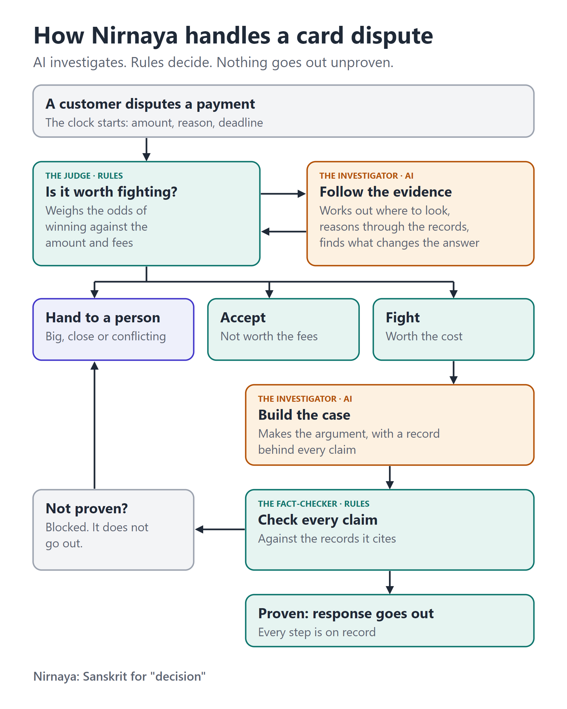

# Nirnaya

**A dispute decision agent for Airwallex merchants.** Nirnaya decides which card disputes are worth fighting, finds the evidence Airwallex cannot see, and refuses to submit any claim it cannot prove.

Built for the Airwallex Developer Lab hackathon, starter kit 4: Dispute Response Agent.

**Videos:**
- Demo Day walkthrough (one case, end to end): https://www.youtube.com/watch?v=Hm8WLYpJ8l0
- Build Phase walkthrough (under 5 minutes): https://youtu.be/jdw4ACHd784

<p align="center"></p>

## How it works

The model never decides anything on its own. Authority is split three ways:

| Part | Role | Code |
|---|---|---|
| **Investigating agent** (LLM) | Searches the merchant's systems for evidence and drafts structured claims. It authorises nothing. | `nirnaya/agent/`, `nirnaya/llm/` |
| **Decision engine** (deterministic) | Accepts, challenges or refers, using the merchant's fees and costs at each dispute stage. It names the missing evidence that would change its decision, and the agent searches only for that. | `nirnaya/engine/` |
| **Verifier** (deterministic) | Checks every claim against its source record: amounts, dates, names, what the record proves, consistency across records, merchant and hash. Any failure blocks submission. | `nirnaya/verifier/` |

Every write to Airwallex goes through one guarded gateway (`nirnaya/guardrails/`). Before it sends, it re-fetches the dispute, re-checks stage, status, amount, deadline and authority, re-runs the decision, and attaches an idempotent `request_id`. Hard cases go to a person with the reason and the evidence. **`DRY_RUN=true` is the default.**

The design is in [`docs/spec.md`](docs/spec.md) and [`docs/architecture.md`](docs/architecture.md). Each kit 4 requirement, and where it is met, is in [`docs/kit4-checklist.md`](docs/kit4-checklist.md).

## 1. Run it offline (no keys)

Requires Python 3.11+ and [uv](https://docs.astral.sh/uv/). Commands are for bash (macOS, Linux, or Git Bash on Windows).

```bash
git clone https://github.com/rachanna/nirnaya.git
cd nirnaya
uv sync
uv run python -m nirnaya.demo              # kit 4 in the terminal
uv run streamlit run app/streamlit_app.py  # the demo console, http://localhost:8501
uv run pytest                              # about 1,900 tests, no network
```

Offline, the merchant systems are synthetic and Airwallex is an in-memory fake.

## 2. Run it with Claude

```bash
cp .env.example .env
```

Set these in `.env`:

```bash
NIRNAYA_AGENT=llm
ANTHROPIC_API_KEY=your-key
```

The model is `claude-sonnet-5-5` unless you set `NIRNAYA_MODEL`.

| What | Command |
|---|---|
| Check the setup (one small model call; never calls Airwallex) | `uv run python -m nirnaya.preflight --live` |
| Demo console, with Claude reading notes and redrafting | `uv run streamlit run app/streamlit_app.py` |
| Web demo: the recorded sandbox run, a live tab with Claude (Airwallex simulated), and the results. Needs Node.js 18+ | `cd web && npm install && npm run build && cd ..`, then `uv run python -m nirnaya.web`, http://localhost:8000 |
| Live model tests | `NIRNAYA_LIVE_LLM=1 uv run pytest -m live -s` |

## 3. Run kit 4 on the Airwallex sandbox

You need an Airwallex sandbox account whose business is registered in a country that accepts online payments, for example the US. Otherwise the sandbox shows "Payments isn't available in your region". Create the keys in the sandbox web app under **Account > Developer > API keys**, then add them to `.env`:

```bash
AIRWALLEX_CLIENT_ID=your-client-id
AIRWALLEX_API_KEY=your-api-key
AIRWALLEX_BASE_URL=https://api.sandbox.airwallex.com
NIRNAYA_AGENT=llm        # Claude investigates and drafts; "scripted" runs with no model
```

1. **Read-only check:** `NIRNAYA_LIVE_AIRWALLEX=1 uv run pytest -m live_airwallex -s`
2. **Dry run (nothing is sent):**
   - Run `uv run python -m nirnaya.sandbox_demo --checkout --fresh`. It creates the three kit payments and writes `.nirnaya/checkout.html`.
   - Open that page and pay each case with the test card `4035 5010 0000 0008`, any future expiry and any CVC.
   - Run `uv run python -m nirnaya.sandbox_demo --checkout`. It raises the three disputes and decides each one.
3. **Real writes:**
   - Set `DRY_RUN=false` in `.env`.
   - Run `uv run python -m nirnaya.sandbox_demo --checkout --fresh --submit`, pay the new cases on the page, then run `uv run python -m nirnaya.sandbox_demo --checkout --submit`.
   - Each `--submit` run asks you to type `SUBMIT`.
   - Set `DRY_RUN=true` again afterwards.

   A real run needs `--fresh`, because it skips any dispute a dry run has already decided.

`--checkout` pays on Airwallex's hosted checkout page. Leave it out only if your sandbox account can confirm card payments server-side.

What a real run does: K1 is challenged at RFI with the evidence PDF, the issuer's rejection is simulated, and K1 is challenged again at chargeback, then left for Airwallex at pre-arbitration. K2 is accepted. K3 is referred to a person. Run state and the audit log are kept in `.nirnaya/`.

## The kit 4 cases

| Case | What Nirnaya does |
|---|---|
| **K1. Large fraud claim** (1,500 USD, RFI, Visa 10.4) | On Airwallex's data alone, it refers, since an accept at RFI would refund. Its intake finds three earlier undisputed orders from the same device and IP in the merchant's order record, so the dispute is worth fighting. Code then fetches the signed delivery to strengthen the case: the fight is worth about 970 USD more than accepting. The response cites both. |
| **K1b. The issuer rejects** | The dispute escalates to chargeback. Nirnaya decides again and challenges again, sending the customer's device ID and IP address (`customer_info`). |
| **K2. Small not-received claim** (15 USD, chargeback, Visa 13.1) | Fighting costs more than the amount, so it accepts (`LOW_VALUE_TRANSACTION`). |
| **K2-C. A fabricated signature** | An unguarded draft says "signed for by J. Smith". The carrier record has no signature, so the verifier blocks the claim and says why. |
| **K3. Credit not processed** (120 USD, chargeback, Visa 13.6) | The customer emailed support twice and got no reply. The maths alone would accept, but a person decides. |

Airwallex's own AI recommendation, when it sends one, is shown beside Nirnaya's decision for comparison. The engine never reads it.

## Results

**On the Airwallex sandbox.** The kit ran end to end with real writes and Claude (`claude-sonnet-5-5`) on 29 and 30 October and on 10 November 2026. Each time, both of K1's challenges were confirmed, K2 was accepted and K3 was referred. The web demo replays the 30 October run. Between 7 and 10 November the sandbox answered every challenge that carried a file with HTTP 500. Nirnaya sent no duplicate, and once the sandbox recovered, it re-sent all three held challenges under their original `request_id`. All three were confirmed ([`docs/failure-cases.md`](docs/failure-cases.md)).

**On 42 synthetic cases**, against three baselines:

| | Nirnaya | Fight everything | Accept everything | Claude alone, told the rules |
|---|---|---|---|---|
| Expected net loss (USD) | 11,417.40 | 11,800.60 | 17,652.00 | 11,342.40 |
| Agrees with the written expert policy | **42/42** | 18/42 | 14/42 | 39/42 |
| Claims a record does not support | **0** | 6 | 0 | 0 |
| Merchant-policy violations | **0** | 13 | 11 | 1 |

"Claude alone" gets every record and the merchant's rules, then decides and drafts with no engine or verifier. It comes close: its lower loss is exactly the three human reviews it skipped. One of those three skips is a rule the prompt left out, which it silently did not apply. Nirnaya's advantage is not better judgement. It is guarantees that don't depend on a prompt or a run: every rule is tested code, every claim is checked against its record, the result is the same on every run, and the model never controls a write. The 42/42 measures whether the code follows its own written policy ([`eval/EXPERT_POLICY.md`](eval/EXPERT_POLICY.md)), not real-world accuracy.

**Where the model adds value:**
- **Reading notes.** On 10 cases where the deciding fact sits only in a driver's or support agent's note, Claude found all 6 real facts and fell for none of the 4 traps, the same in 3 runs. A keyword list sent 3 of the traps to a person. A quote counts only after a person confirms it, and the verifier then checks it word for word.
- **Fixing blocked drafts.** We broke first drafts on purpose. Claude's redraft passed in 15 of 15 cases of each kind of fault. Values written in the wrong form then went out on their own; every overreach still went to a person.

Every table, the repeat runs and the sensitivity to the assumed fees are in [`eval/results/report.md`](eval/results/report.md). Rebuild it with `uv run python -m nirnaya.evaluation.report`.

## Limits

- The merchant systems (orders, carrier, logins, helpdesk, policy) are synthetic and labelled SYNTHETIC. Airwallex is real only in the sandbox runner.
- Win probabilities are fixed priors, shown as priors, not predictions. Fees and priors are merchant configuration; the demo values are assumptions.
- Airwallex details not yet confirmed in its docs are marked `TODO(verify-airwallex-docs)` in the code rather than guessed.
- Counterevidence is only as complete as the contradiction rules in `nirnaya/evidence/catalogue.py`.

## More

- Versioned prompts and configuration: `nirnaya/assets/`, pinned and SHA-256 locked (architecture §16.1).
- Optional LangSmith tracing: set `LANGSMITH_TRACING=true` and `LANGSMITH_API_KEY` in `.env`.
- Failure cases found and fixed: [`docs/failure-cases.md`](docs/failure-cases.md).
