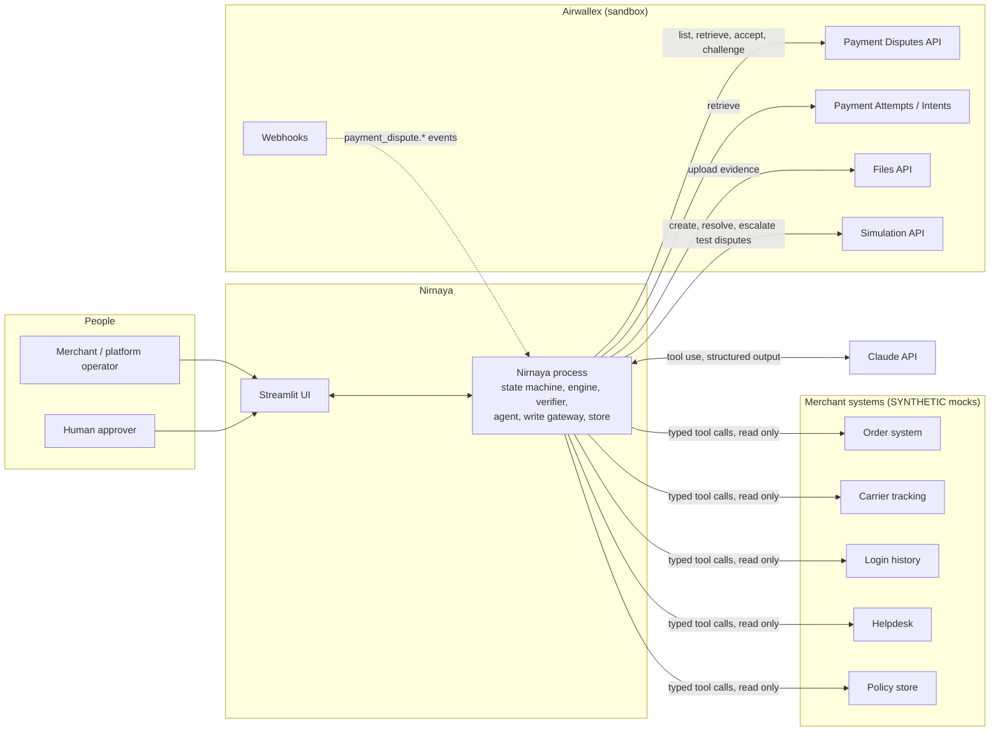
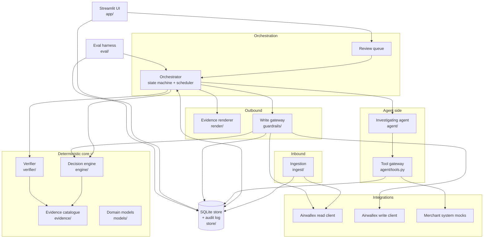
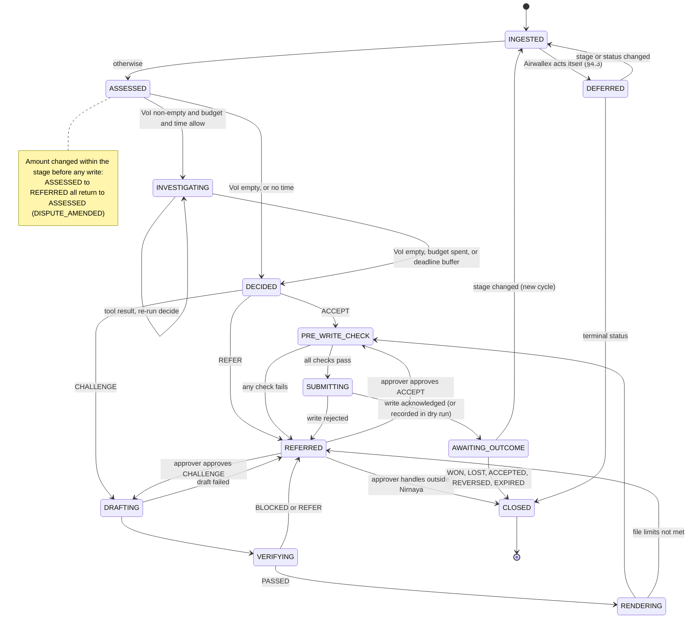
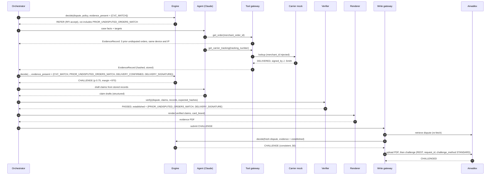
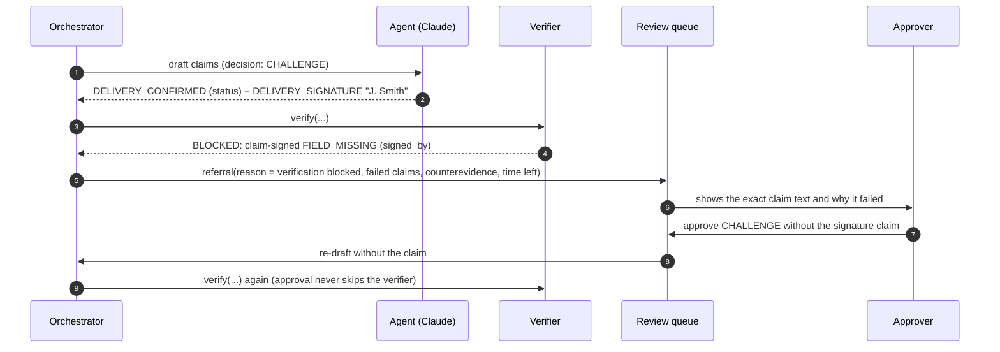
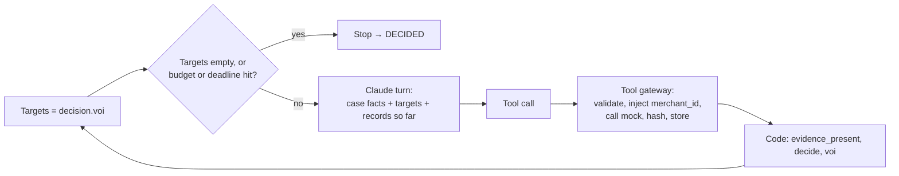
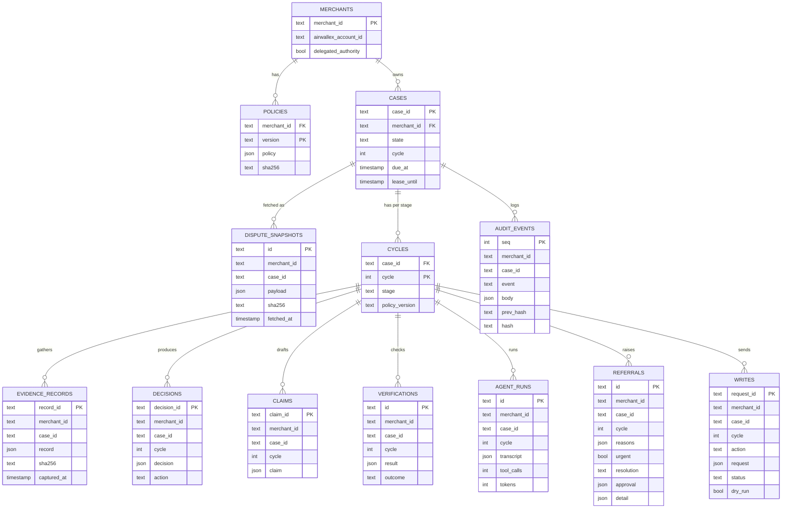
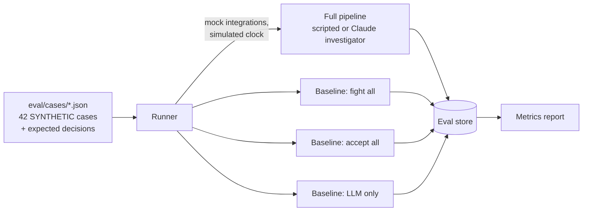

# Nirnaya: Architecture

**Audience:** the people and agents building Nirnaya (Milestones 2–7).
**Read with:** [`docs/spec.md`](spec.md) (what and why) and [`CLAUDE.md`](../CLAUDE.md) (rules and conventions).
**Status legend:** ✅ built and tested · 🔶 partly built · ⬜ planned.
**Airwallex facts** cite the page they come from, checked 2026-10-23. Anything not confirmed is marked `TODO(verify-airwallex-docs)` and must not be implemented from memory.

---

## Contents

1. [Purpose, scope and invariants](#1-purpose-scope-and-invariants)
2. [System context](#2-system-context)
3. [Components](#3-components)
4. [Case lifecycle state machine](#4-case-lifecycle-state-machine)
5. [Key flows](#5-key-flows)
6. [Decision and verification consistency](#6-decision-and-verification-consistency)
7. [Write gateway and guardrails](#7-write-gateway-and-guardrails)
8. [Investigating agent](#8-investigating-agent)
9. [Airwallex integration](#9-airwallex-integration)
10. [Data model and storage](#10-data-model-and-storage)
11. [Tenant isolation and security](#11-tenant-isolation-and-security)
12. [Failure modes](#12-failure-modes)
13. [Observability and audit](#13-observability-and-audit)
14. [Evaluation](#14-evaluation)
15. [User interface](#15-user-interface)
16. [Deployment and configuration](#16-deployment-and-configuration)
17. [Open decisions](#17-open-decisions)
18. [Build map](#18-build-map)

---

## 1. Purpose, scope and invariants

Nirnaya decides which card disputes a merchant should fight, gathers the evidence that would change that decision, and refuses to submit any claim it cannot prove. It runs one investigating agent inside a deterministic Python state machine. The agent gathers and drafts; code decides, verifies and writes.

### 1.1 Invariants

These are the seven rules in `CLAUDE.md`, restated with **where each is enforced**. A change that weakens any of them needs explicit sign-off.

| # | Invariant | Enforced in | Proven by |
|---|---|---|---|
| I1 | The LLM authorises nothing. Only the engine decides; only the verifier clears a submission. | `nirnaya/engine/decide.py` `decide()`; `nirnaya/verifier/verify.py` `verify()`; ⬜ the write gateway refuses any write without both (§7) | ✅ engine and verifier tests; ⬜ `tests/guardrails/` |
| I2 | The engine and verifier are deterministic: no LLM, no randomness, no network, no clock. | Ruff `banned-api` on `nirnaya/{models,evidence,engine,verifier}`; `tests/test_determinism.py` (AST scan, identical output across `PYTHONHASHSEED`) | ✅ |
| I3 | Every claim is bound to evidence. | `Claim.source_record_id` / `source_field` are required non-blank fields (`nirnaya/models/claim.py`) | ✅ `tests/models/test_claim.py` |
| I4 | Customer and support text is untrusted data. | Customer-authored records establish nothing (`nirnaya/evidence/catalogue.py` `record_establishes`); ⬜ the agent prompt passes tool results only as delimited data (§8.4) | ✅ catalogue tests; ⬜ agent tests |
| I5 | Writes are guarded: re-fetch, re-check, unique `request_id`, `DRY_RUN=true` by default. | ⬜ `nirnaya/guardrails/` write gateway (§7) | ⬜ |
| I6 | Tenant isolation by `merchant_id`. | `TenantMismatchError` in `nirnaya/engine/core.py`; `case_records()` in `nirnaya/evidence/derive.py`; verifier scope checks; ⬜ the repository layer (§10.3) | ✅ partly; ⬜ store tests |
| I7 | Never invent Airwallex API details. | Enums carry documented values (`nirnaya/models/enums.py`); `TODO(verify-airwallex-docs)` markers | review |

### 1.2 In scope

- Card disputes at the **RFI**, **pre-chargeback** and **chargeback** stages, decided automatically. At RFI only a challenge is automated; an RFI accept issues a full refund and goes to a person.
- Pre-arbitration and arbitration: recognised, then referred to a human or recorded.
- The product is the Airwallex hackathon **kit 4, Dispute Response Agent** ([kit 4 guide](https://airwallexdev.com/agentic-banking-builder-guide.md)). Its three cases and rejection step are the demo (§5).
- Single merchants and platforms with several connected merchants (§11.2).
- The Airwallex **sandbox**, with mocked merchant systems.

### 1.3 Out of scope

- Real order, carrier, login or helpdesk integrations. They are SYNTHETIC mocks with a stable interface (§3.2), so real adapters can replace them later.
- Production deployment, high availability and horizontal scaling (§16).
- Predicting issuer or network outcomes. Win probabilities are fixed priors and are shown as such.

---

## 2. System context



Trust boundaries:

- **Airwallex → Nirnaya:** webhook payloads only *trigger* work. Every write is preceded by a fresh `retrieve` (§7).
- **Merchant systems → Nirnaya:** every response is snapshotted as a hashed `EvidenceRecord` by code before anything else sees it.
- **Nirnaya → Claude:** Claude receives case facts and records as data. Its output is a proposal: tool calls and structured claim drafts. It has no write path.
- **Nirnaya → Airwallex writes:** exactly one module, the write gateway, can call write endpoints.

---

## 3. Components

### 3.1 Component diagram



### 3.2 Component responsibilities

| Component | Package | Status | Responsibility | Authority | Depends on |
|---|---|---|---|---|---|
| Domain models | `nirnaya/models/` | ✅ | Pydantic types: `Dispute`, `PaymentAttempt`, `EvidenceRecord`, `Claim`, `MerchantPolicy`, `Decision`, `Money`, `FxTable`, `DisputeReason` | none | none |
| Evidence catalogue | `nirnaya/evidence/` | ✅ | `FIELD_RULES`, `REQUIRED_EVIDENCE`, `CONTRADICTION_RULES`, `TEMPORAL_RULES`, `REASON_SPECIFIC`, `render_claim_text`; `evidence_present()`, `contradictory_record_ids()`, `late_evidence_notes()` | data | models |
| Decision engine | `nirnaya/engine/` | ✅ | `decide()` → `Decision` with `voi`; `value_of_information()` | **sole decider** | models, evidence |
| Verifier | `nirnaya/verifier/` | ✅ | `verify()` → `VerificationResult` | **sole clearer** | models, evidence |
| Ingestion | `nirnaya/ingest/` *(new package)* | 🔶 (domain disputes; wire mapping in M5) | Poll and reconcile disputes; optional webhook receiver; snapshot disputes and payment attempts; map wire → domain | none | Airwallex read client, store |
| Case store | `nirnaya/store/` | ✅ | SQLite schema, repositories scoped by `merchant_id`, hash-chained audit log | none | models |
| Orchestrator | `nirnaya/orchestrator/` | ✅ | Persistent case state machine, scheduler tick, deadline watchdog, command handling | routes only | everything inbound and outbound |
| Review queue | `nirnaya/orchestrator/referrals.py` | ✅ (commands; UI in M7) | Referral records, approver commands | human | store |
| Investigating agent | `nirnaya/agent/` | ✅ (`LLMInvestigator`, `LLMDrafter` on any `LLMClient`; scripted versions for tests and `NIRNAYA_AGENT=scripted`) | Model rounds: choose permitted lookups from VoI targets, stop, draft structured claims | none | `nirnaya/llm/`, tool gateway |
| Tool gateway | `nirnaya/agent/tools.py` | ✅ | Validate tool arguments, inject `merchant_id`, call mocks, wrap results as hashed `EvidenceRecord`s, persist them | none | mocks, store |
| Evidence renderer | `nirnaya/render/` *(new package)* | ✅ | Verified claims → evidence files that meet card-brand format and size limits | none | models |
| Write gateway | `nirnaya/guardrails/` | 🔶 (checklist, ledger, dry run against ports; wire request in M5) | Pre-write checklist, deterministic `request_id`, write ledger, dry-run; the only caller of write endpoints | **enforces** | engine, Airwallex clients, store |
| Airwallex clients | `nirnaya/integrations/airwallex/` | ⬜ | Auth, typed read client, separate write client, simulation helpers | none | httpx |
| Merchant mocks | `nirnaya/integrations/mocks/` | ✅ (plus `FakeAirwallex` for tests) | SYNTHETIC order, carrier, login, helpdesk and policy systems behind `Protocol` interfaces | none | none |
| Demo config | `nirnaya/config/demo.py` | ✅ | `DEMO_POLICY`, `DEMO_FX` (labelled ASSUMPTION) | data | models |
| Eval harness | `eval/` (data), `nirnaya/evaluation/` (code) | 🔶 | Case fixtures and expert policy ✅; runner, baselines, metrics ⬜ | none | orchestrator, store |
| UI | `app/` | ⬜ | Streamlit views and approver actions | none | store, review queue |

`ingest/` and `render/` are additions to the layout in `CLAUDE.md`. They keep wire-format handling and file generation out of the orchestrator.

### 3.3 Dependency rules

- `models`, `evidence`, `engine` and `verifier` import nothing outside themselves and the standard library plus Pydantic. This is enforced by ruff and the AST test.
- Only `guardrails/` may construct the Airwallex **write** client. ⬜ An AST test (`tests/test_architecture.py`) will assert that no other package imports it.
- `app/` imports only `store` read models and orchestrator *commands*. It never calls `decide`, `verify` or a client directly.
- The agent never receives a client or the store. It receives the tool gateway, which exposes typed read-only tools.

---

## 4. Case lifecycle state machine

A **case** is one dispute for one merchant. When Airwallex escalates the dispute (a new stage), the same case starts a new **cycle**. Decisions, drafts and writes belong to a cycle, so evidence gathered earlier is reused but a decision is never carried across stages.

### 4.1 States



| State | Meaning | Handler does | Exits when |
|---|---|---|---|
| `INGESTED` | New dispute or new cycle | Close if Airwallex already resolved it; apply deferral rules; resolve ownership (§11.2); snapshot the payment attempt; **look up the order and the helpdesk** (code, not the agent): the order is the anchor for every other lookup, and `unanswered_customer_contacts()` needs the helpdesk | Always, in one step |
| `DEFERRED` | Airwallex will act; Nirnaya records only | Nothing; it is re-evaluated when Airwallex reports a change | Status or stage changes |
| `ASSESSED` | Initial decision on current evidence | `evidence_present()`, `contradictory_record_ids()`, `unanswered_customer_contacts()`, `decide()` | Always |
| `INVESTIGATING` | Agent searching for VoI evidence | One agent turn per tick (§8) | VoI empty, budget spent, or deadline buffer |
| `DECIDED` | Engine has decided this cycle | Persist the `Decision`; route by `action` | Always |
| `DRAFTING` | Agent drafts structured claims | Draft → `Claim`s (§8.6) | Drafts stored, or drafting failed |
| `VERIFYING` | Verifier runs | `verify()` with stored records and captured hashes | Always |
| `RENDERING` | Evidence files built | `render/` (§9.6) | Files within limits, or not |
| `PRE_WRITE_CHECK` | Guardrails | §7 checklist | Pass or fail |
| `SUBMITTING` | Write in flight | Write gateway call, ledger update | Acknowledged or rejected |
| `AWAITING_OUTCOME` | Submitted; waiting on issuer or scheme | Nothing; ingestion updates status | Terminal status or stage change |
| `REFERRED` | Human needed | Referral record with reasons and `detail` (the claims that failed and why, the conflicting or unanswered records, or the guard failure), and time left; escalated to urgent inside the deadline buffer (§4.4) | Approver command |
| `CLOSED` | Terminal | Nothing | |

### 4.2 Execution model

- **One step per case per tick.** The scheduler loads runnable cases, earliest `due_at` first, and runs one handler for each. Each handler is a pure function `(case, store snapshot, now) → (new state, effects)`, applied in **one SQLite transaction** together with an audit event.
- **Idempotent and resumable.** Re-running a handler after a crash produces the same effects. Writes are protected by the `request_id` ledger (§7.3), so `SUBMITTING` can be retried safely.
- **Leases.** `cases.lease_until` stops two workers advancing the same case. The demo runs one worker, but the column keeps the invariant explicit.
- **Per-case isolation.** A step that raises is rolled back with its transaction, audited as `STEP_FAILED` (state and error type), and skipped; the tick carries on with the other cases. After 3 failures in the same state the case is referred (urgent, `STEP_FAILED`), except in `SUBMITTING`: a write in flight is never interrupted and keeps reconciling through the gateway. `Settings.isolate_step_failures` turns this off for debugging.
- **Amendments re-decide.** If ingestion sees the dispute's amount or currency change within the same stage while the case is between `ASSESSED` and `REFERRED` (no write yet), the case returns to `ASSESSED` (`EXTERNAL_REASSESS`), any open referral is closed as `SUPERSEDED_BY_DISPUTE_CHANGE`, every approval of the cycle is voided, and `DISPUTE_AMENDED` is audited. The new decision gets a new draft, verification and PDF with the current amount.
- **Clock injection.** The orchestrator owns `now` and passes it to the guardrails and the watchdog. The engine and verifier never see a clock (I2).

### 4.3 Deferral rules (Airwallex acts on its own)

| Rule | Source | Handling |
|---|---|---|
| Full refund already posted: Airwallex auto-defends at every stage except arbitration | [Handle disputes using our APIs](https://www.airwallex.com/docs/payments/payment-operations/disputes/handle-disputes-using-our-apis) | `DEFERRED` when `refunded == amount` |
| Partial refund: no automatic action | same | Normal path; the verifier nets refunds (`AmountBasis.NET_OF_REFUNDS`) |
| Pre-chargeback auto-accepted below the account's threshold ("under 60 USD or equivalent" on one page; "thresholds configured for your account" on another) | same, and [How disputes work](https://www.airwallex.com/docs/payments/payment-operations/disputes/dispute-flow) | `DEFERRED` when below the threshold in merchant config. `TODO(verify-airwallex-docs)`: whether the threshold can be read through the API |
| Pre-arbitration: Airwallex reviews it and accepts or responds for you; only AMEX shows "Requires response" | How disputes work | Non-AMEX: `DEFERRED`. AMEX with `REQUIRES_RESPONSE`: the engine refers (`STAGE_NOT_AUTOMATED`) |
| Arbitration: no merchant action | How disputes work | `DEFERRED` |
| **Sandbox:** pre-chargeback disputes auto-accept within the same second | [kit 4 guide](https://airwallexdev.com/agentic-banking-builder-guide.md) | Nirnaya sees them already `ACCEPTED` (`STATUS_NOT_ACTIONABLE`). The pre-chargeback logic is exercised by engine tests and offline demos only |

The spec also mentions Visa CE3.0 auto-challenge. It is not described on the pages checked: `TODO(verify-airwallex-docs)`.

### 4.4 Deadline watchdog

| Stage | Airwallex deadline | Default buffer (ASSUMPTION, policy config) |
|---|---|---|
| Pre-chargeback | 65 hours after receipt, then auto-accepted | 12 hours |
| Chargeback | 15 days after escalation, then auto-accepted | 2 days |
| RFI | 15 days after receipt, then it expires | 2 days |

Source: [How disputes work](https://www.airwallex.com/docs/payments/payment-operations/disputes/dispute-flow).

On every tick, any case not in `AWAITING_OUTCOME`, `DEFERRED`, `CLOSED` or `SUBMITTING` with `now ≥ due_at − buffer` moves to `REFERRED` with `urgent=true`. The agent's own stop condition uses a larger buffer, so the watchdog is a backstop rather than the normal exit.

A case already `REFERRED` is not moved, but once inside the same buffer its open referral is marked urgent (`REFERRAL_ESCALATED`, once), so a review queue can put it first before Airwallex's own deadline action.

---

## 5. Key flows

Each flow follows the kit's demo structure: **goal → initial plan → new information → revised decision → resulting status**. All numbers are on the demo policy, in USD, and asserted in `tests/test_kit4_scenarios.py`.

### 5.1 Kit case 1: large fraud claim (1,500, RFI, Visa 10.4), recover revenue

With the payment attempt alone (CVC match, no 3DS, AVS not checked) the maths says ACCEPT (p = 0.10, margin −5), which at RFI would be referred. The order lookup at `INGESTED` brings the order history: 3 earlier undisputed orders from the same device and IP. That gives p = 0.60, G_cb = 830 and margin +745, so the decision is CHALLENGE at assessment, and VoI is empty, so no further search is needed. The verified claim cites the prior orders. (With the signed delivery also on file, p rises to 0.75 and the margin to +970; the evaluation fixture assumes full investigation.) The diagram shows the general pattern for a case whose deciding evidence is found by the investigator.



### 5.2 Kit case 1b: the issuer rejects the evidence

In the sandbox the case is created at RFI, challenged, and then moved on with the simulated escalate call ([kit 4 guide](https://airwallexdev.com/agentic-banking-builder-guide.md)). It arrives back as `CHARGEBACK` / `REQUIRES_RESPONSE`, which is a **new cycle** of the same case (§4). The engine re-decides at chargeback on the same verified records: 0.75 × 1,500 − 20 − 50 − 10 = +1,045 → CHALLENGE again with the same verified package. Escalating from `CHARGEBACK` is not supported in the sandbox, so the demo ends there.

### 5.3 Kit case 2: small not-received claim (15, chargeback, Visa 13.1), accept

The carrier shows DELIVERED with no signature: p = 0.60, margin −71 → ACCEPT. Even at the highest allowed prior (1 − q = 0.90) challenging would not pay, so the accept carries `LOW_VALUE_TRANSACTION`. The kit's point holds: the dispute fee exceeds the amount at risk.

### 5.4 Kit case 2-C: block a fabrication (same case)

The demo shows what an **unguarded** agent (the LLM-only baseline, §14) would have submitted on case 2: "Delivery signed for by: J. Smith". `verify()` blocks it with `FIELD_MISSING` on `signed_by`, and the page shows the exact claim and the reason. In Nirnaya's own pipeline the same block applies to any draft, including one made after an approver overrides the economics:



### 5.5 Kit case 3: credit not processed (120, chargeback, Visa 13.6), escalate

`CREDIT_NOT_PROCESSED` maps to UNKNOWN, and the maths alone would accept (unknown prior 0.10, margin −68). The helpdesk lookup at `INGESTED` finds two customer emails before the dispute with no merchant reply on either ticket. `unanswered_customer_contacts()` returns both, and the engine refers with `UNANSWERED_CUSTOMER_CONTACT`. A person decides whether a refund is owed.

### 5.6 Pre-chargeback early accept (offline only)

A pre-chargeback fraud dispute with only AVS + CVC (p = 0.30, `G_cb` = 0) is accepted because the resolution fee is cheaper than the chargeback path. This remains an engine test and an offline demo: in the sandbox, pre-chargeback disputes auto-accept within the same second (§4.3).

---

## 6. Decision and verification consistency

**The gap.** `decide()` runs on evidence derived from *records* (`evidence_present()`). The submission proves only what its *verified claims* establish (`VerificationResult.established`). These can differ if the draft omits or botches a fact. A challenge could then go out at a win prior the submission does not support.

**The rule.** At `PRE_WRITE_CHECK` for a CHALLENGE, the write gateway re-runs:

```python
decide(
    fresh_dispute,
    policy,
    verification.established,
    ownership_resolved=...,
    contradictory_record_ids=...,
    fx=...,
)
```

The challenge proceeds only if that returns `Action.CHALLENGE`. Otherwise the case is `REFERRED` with the reason `DECISION_NOT_SUPPORTED_BY_VERIFIED_CLAIMS`.

The re-run also catches anything that changed on the Airwallex side since the decision: amount, stage or status (the re-fetched dispute is the input).

For an ACCEPT there is nothing to prove, but the gateway still re-runs `decide()` on the re-fetched dispute, so a stage or status change stops the write.

**Dates across records.** Both sides use the same contradiction source (`find_contradictions()`), which includes `TEMPORAL_RULES`. A trusted record whose date is impossible against another record or the dispute contradicts the fact it establishes:

| Fact | Field | Must be |
|---|---|---|
| Delivery confirmed or signed | carrier `delivered_at` | not before its own order's `placed_at` (the order with the same tracking number) |
| Usage after renewal | login `active_after_renewal_at` | not before the disputed order (the renewal charge) |
| Cancellation terms accepted | policy `cancellation_terms_accepted_at` | not after the disputed order |
| Any order fact | order `placed_at` | not after the dispute opened |
| All of the above, and the purchase-device login | the dated field | not after the record's capture; readable with a time zone |

The engine then refers with `CONTRADICTORY_RECORDS` before any drafting. It records each contradiction (record, fact, description) in `Decision.inputs`, and the referral copies them from the decision, so it always matches what was decided; a claim on such a record is `CONFLICT` in the verifier, and every reason a record contradicts a claim is surfaced.

Each record is compared with its own order: the order that shares the rule's `order_link` field with it (a carrier record's `tracking_number`); otherwise the disputed order, whose `order_id` is the dispute's `merchant_order_id` (login and policy facts are about the disputed charge, so they always use it); otherwise all orders on file, leniently (earliest for lower bounds, latest for upper). Only trusted, intact orders count, and with none the order bounds are skipped. An unreadable or out-of-range timestamp is a clash. Tampered records (hash mismatch) neither anchor nor clash. `derive.cross_check()` computes rule contradictions, date clashes and late notes in one pass per case.

Evidence dated after the dispute opened still counts; it is listed in `VerificationResult.notes`. If the case is referred, the notes are in the referral. If it is submitted, `SUBMITTED_WITH_NOTES` records them with the `request_id` and the authority (`DELEGATED`, or `APPROVED` and the approver) for review afterwards. ASSUMPTION: expert policy, like the rest of the catalogue.

---

## 7. Write gateway and guardrails

### 7.1 The only write path

`nirnaya/guardrails/gateway.py` ⬜ exposes:

```python
submit_accept(case_id, cycle, *, now) -> WriteResult
submit_challenge(case_id, cycle, *, now) -> WriteResult
```

They take **ids, not objects**. The gateway reloads everything it needs from the store, so a caller cannot pass a doctored decision.

### 7.2 Pre-write checklist (all must pass; the first failure refers the case)

| # | Check | Fails as |
|---|---|---|
| 1 | Re-fetch the dispute from Airwallex (`retrieve`) | `REFETCH_FAILED` |
| 2 | `status is ACTIONABLE_STATUS` (`REQUIRES_RESPONSE`) | `STATUS_CHANGED` |
| 3 | `stage`, `amount`, `currency` equal to those the **decision** was made on (`decision.stage`, `decision.inputs.amount`), not merely the latest snapshot | `DISPUTE_CHANGED` |
| 4 | `now < due_at − buffer(stage)` | `TOO_CLOSE_TO_DEADLINE` |
| 5 | The dispute's account matches the case's merchant, and the merchant has delegated authority or a human approval exists for this cycle | `NO_AUTHORITY` |
| 6 | `decide()` re-run on the fresh dispute (and, for a challenge, on `established`) returns the same action (§6) | `DECISION_CHANGED` / `DECISION_NOT_SUPPORTED_BY_VERIFIED_CLAIMS` |
| 7 | Challenge only: the stored `VerificationResult.outcome` is `PASSED`; every cited record's stored hash equals its capture hash; evidence files are uploaded and their `file_id`s recorded | `NOT_VERIFIED` / `EVIDENCE_CHANGED` / `FILES_MISSING` |
| 8 | Challenge only: the request uses `challenge_method: STANDARD`, so Nirnaya's verified package is what is submitted. AI Dispute Automation is used only when explicitly requested ([Challenge API reference](https://www.airwallex.com/docs/api/payments/payment_disputes/challenge.md)); its `recommendation` is stored as a comparison input, never as the decision | `WRONG_CHALLENGE_METHOD` |
| 9 | No ledger row exists for this `request_id` with status `SENT` or `CONFIRMED` | returns the earlier result (idempotent) |

A **human approval** satisfies check 5 and overrides the engine's economic REFER. It never satisfies check 7: an approved challenge still needs a `PASSED` verification.

Each approval is **bound to what the approver saw** ([kit 4 guide](https://airwallexdev.com/agentic-banking-builder-guide.md)): the action, the amount and currency, the dispute id and merchant, and the hash of the evidence package (verified claims plus rendered files). The gateway re-checks all of them; if any has changed since the approval, it is void and the case is referred again.

### 7.3 Idempotency

- `request_id` is a **UUID**, reused only to retry the same operation. Reusing it for a different operation within 7 days returns `duplicate_request_id` ([kit 4 guide](https://airwallexdev.com/agentic-banking-builder-guide.md)).
- Nirnaya derives it deterministically as a **UUIDv5** of (merchant, case, cycle, stage, action, decision id, attempt), so a retry after a crash sends the same id and needs no stored randomness.
- `attempt` is 1 plus the number of `FAILED` ledger rows for the same cycle and action. A timeout (`PENDING`/`UNKNOWN`) does not count, so its retry reuses the id; a new attempt after a rejected write (for example, after a human approval) is a new operation and gets a new id.
- Both accept and challenge require `request_id` ([API reference](https://www.airwallex.com/docs/api/payments/payment_disputes/retrieve), [Challenge API reference](https://www.airwallex.com/docs/api/payments/payment_disputes/challenge.md)).
- Never retry a write that timed out without first re-fetching the dispute to see whether it landed (§12).
- The `writes` table has a **unique** constraint on `request_id`. The row is inserted as `PENDING` *before* the HTTP call and updated to `SENT`, `CONFIRMED` or `FAILED` after it. On restart, `PENDING`/`SENT` rows are reconciled by re-fetching the dispute rather than re-sending.

### 7.4 Dry run

`DRY_RUN=true` is the default. The gateway runs every check and builds the exact request, then stores it in the ledger as `DRY_RUN` instead of sending it. The case moves to `AWAITING_OUTCOME` with `dry_run=true`. In the sandbox, the simulation API can then resolve the dispute (§9.4).

---

## 8. Investigating agent

### 8.1 Role

The agent turns a VoI target list ("find `DELIVERY_CONFIRMED`") into tool calls, decides when nothing more is worth fetching, and drafts structured claims from stored records. It cannot decide, verify, write, choose a merchant, or see another case.

### 8.2 Loop

Each `INVESTIGATING` tick runs **one round** (`nirnaya/agent/llm_investigator.py`). In a round the model is offered only the tools the current targets need, each with its `key` argument as an `enum` of keys the case allows, plus `finish`. It may make up to 3 lookups in up to 6 turns. The machine then re-decides, recomputes the targets and starts another round if anything is still worth fetching and the budgets allow. Every model call (investigation round or draft) is stored as an `AgentRun` in `agent_runs`, in the same transaction as its step: provider, model, turns, stop reason, tokens, tool calls with outcomes, dropped draft items, transcript.



Targets are **recomputed by code** after every tool result (`nirnaya/agent/targets.py`): every evidence set VoI reports as flipping the decision (whole sets, including pairs that only flip together; a set needing a payment-attempt fact is skipped), plus, when the maths favours a challenge, the reason's unmet evidence requirements. Without the second part a challenge could be decided but never verified (for example, a subscription case decided on accepted terms still needs usage after renewal or no prior contact). Types no tool can find (the payment-attempt facts) are dropped. The agent never adds a target of its own, and the tool gateway accepts only lookup keys that come from the dispute or the case's own order records.

### 8.3 Tools

| Tool | Serves evidence types | Lookup keys (from the dispute, not the LLM) |
|---|---|---|
| `get_order` | `ORDER_PLACED`, `DISTINCT_TRANSACTIONS`, `REFUND_ISSUED`, `PRIOR_UNDISPUTED_ORDERS_MATCH` | `merchant_order_id` (an Airwallex dispute field, per the webhook sample on [Handle disputes using our APIs](https://www.airwallex.com/docs/payments/payment-operations/disputes/handle-disputes-using-our-apis)) |
| `get_carrier_tracking` | `DELIVERY_CONFIRMED`, `DELIVERY_SIGNATURE` | tracking number from the order record |
| `get_login_history` | `ACCOUNT_LOGIN_MATCH`, `USAGE_AFTER_RENEWAL` | customer account from the order record |
| `get_helpdesk_summary` | `NO_PRIOR_CUSTOMER_CONTACT` (and surfaces customer messages as counterevidence). Also run by code at `INGESTED` for every case, because `unanswered_customer_contacts()` needs it | customer account |
| `get_policy_acceptance` | `CANCELLATION_TERMS_ACCEPTED` | customer account |

`THREE_DS_AUTHENTICATED`, `AVS_MATCH` and `CVC_MATCH` come from the payment-attempt snapshot at ingestion, not from the agent. They are final once ingested, so a VoI target with no tool (for example `AVS_MATCH` when AVS was not checked) is dropped from the agent's list.

Every tool schema excludes `merchant_id` and `case_id`; the gateway injects them from the case. Each result is stored as an `EvidenceRecord` (via `EvidenceRecord.create`, so it is hashed at capture). The record returned to Claude is that stored record.

### 8.4 Untrusted text

- The system prompt is static and contains no case data.
- Case facts and records are sent as tool results or user content inside explicit delimiters, labelled as data. They are never concatenated into instructions.
- **Customer-authored records are never shown to the model**: they appear only as `{id, system, author: CUSTOMER, content: withheld}` (`nirnaya/agent/context.py`). The model doesn't need their content, because they establish nothing (`record_establishes`) and the engine uses only their existence (`unanswered_customer_contacts`). This removes the main injection path rather than labelling it.
- The drafter can cite only the case's merchant and third-party records (a JSON-schema `enum` of ids), and only the facts allowed for the reason.
- Tool arguments are validated against the schema. Free-text arguments are rejected where a key is expected.

### 8.5 Budgets and stop conditions

| Condition | Default (ASSUMPTION, config) |
|---|---|
| VoI target list empty | n/a |
| Tool calls per cycle | 8 |
| Model tokens per cycle (summed from `agent_runs`) | 60k |
| Lookups per investigation round | 3 |
| Model turns per round | 6 |
| Model call timeout (SDK) | 60 s |
| Agent deadline buffer (larger than the watchdog's) | pre-chargeback 18 h, chargeback 3 d |
| Same tool failing twice | stop that target |
| Model error or refusal | stop; decide on the evidence so far |

An agent failure never produces a challenge on its own. The engine decides on whatever evidence was stored, and a CHALLENGE still needs a verified draft.

### 8.6 Drafting

The agent outputs a list of **claim drafts** through structured output, one draft per fact: `source_record_id`, `source_field`, `establishes`, `extracted_value`, `normalised_value`.

Code then:
- assigns `id`, `case_id` and `merchant_id`;
- sets `text = render_claim_text(establishes, normalised_value)` (so the text cannot carry anything the structure does not);
- builds `Claim`s.

The status and contradiction ids are left for `verify()`, which ignores any incoming values.

Model: chosen by configuration through the provider-neutral `LLMClient` (`nirnaya/llm/`): `NIRNAYA_LLM_PROVIDER` is `anthropic` (default) or `openai`, and `NIRNAYA_MODEL` sets the model (default `claude-sonnet-5-5` for Anthropic; required for OpenAI). Structured drafts use a forced tool call, which both providers support, rather than a provider-specific structured-output feature. Data from records is passed only as tool results or messages wrapped by `untrusted()`; the system prompt is static.

---

## 9. Airwallex integration

### 9.1 Environment and auth

| Item | Value | Source |
|---|---|---|
| Sandbox API base URL | `https://api.sandbox.airwallex.com` | [Airwallex Developer Lab](https://airwallexdev.com/) |
| Login | `POST /api/v1/authentication/login` with headers `x-client-id` and `x-api-key`, no body → bearer token valid **30 minutes** | [kit 4 guide](https://airwallexdev.com/agentic-banking-builder-guide.md) |
| Rate limits (sandbox) | 20 requests/s overall, 10 per endpoint, 10 concurrent; back off on 429; no parallel bursts in the demo | [kit 4 guide](https://airwallexdev.com/agentic-banking-builder-guide.md) |
| Amounts | Major units (not cents), which matches `Money.amount` | [kit 4 guide](https://airwallexdev.com/agentic-banking-builder-guide.md) |
| Writes | REST only. The MCP challenge tool lacks required fields | [kit 4 guide](https://airwallexdev.com/agentic-banking-builder-guide.md) |
| Keys | Created in the sandbox web app: Account > Developer > API keys | Developer Lab |
| Docs MCP (for builders) | `https://mcp.sandbox.airwallex.com/docs` | Developer Lab |

### 9.2 Endpoints used

| Purpose | Method and path | Client | Source |
|---|---|---|---|
| List disputes | `GET /api/v1/pa/payment_disputes` (filters: `stage`, `status`, `reason_code`, `due_date`, `updated_at`) | read | [Handle disputes using our APIs](https://www.airwallex.com/docs/payments/payment-operations/disputes/handle-disputes-using-our-apis) |
| Retrieve dispute | `GET /api/v1/pa/payment_disputes/{dispute_id}` | read | same |
| Challenge | `POST /api/v1/pa/payment_disputes/{dispute_id}/challenge`; allowed at `RFI` or `CHARGEBACK` with `REQUIRES_RESPONSE` | **write** | [Challenge API reference](https://www.airwallex.com/docs/api/payments/payment_disputes/challenge.md) |
| Accept | `POST /api/v1/pa/payment_disputes/{dispute_id}/accept`; required `request_id`, `reason` from `AcceptReason` | **write** | [kit 4 guide](https://airwallexdev.com/agentic-banking-builder-guide.md); [API reference](https://www.airwallex.com/docs/api/payments/payment_disputes/retrieve) |
| Upload evidence file | `POST /files/upload` on `files.sandbox.airwallex.com` ([kit 4 guide](https://airwallexdev.com/agentic-banking-builder-guide.md)), or `POST /api/v1/files/upload/{file_path}` (disputes guide) → `file_id`. **Conflict: `TODO(verify-airwallex-docs)`** | **write** | both |
| Create test payments | `POST /api/v1/pa/payment_intents/create`, then `/{id}/confirm` (test card `4035501000000008`) | sim | [kit 4 guide](https://airwallexdev.com/agentic-banking-builder-guide.md) |
| Payment attempt / intent read | `TODO(verify-airwallex-docs)` | read | n/a |
| Refunds | `GET /api/v1/pa/refunds` | read | [kit 4 guide](https://airwallexdev.com/agentic-banking-builder-guide.md) |
| Simulate create | `POST /api/v1/simulation/pa/payment_disputes/create` | sim | [Simulate payment disputes](https://www.airwallex.com/docs/developer-tools/sandbox-environment/payments/simulate-payment-disputes) |
| Simulate resolve | `POST /api/v1/simulation/pa/payment_disputes/{id}/resolve` (`in_favor_of`: `MERCHANT` → WON or REVERSED; `CUSTOMER` → LOST) | sim | same |
| Simulate escalate | `POST /api/v1/simulation/pa/payment_disputes/{id}/escalate` (declines evidence, moves to the next stage) | sim | same |

The simulation client is constructible only when the base URL is the sandbox host. In the sandbox, escalating from `CHARGEBACK` is not supported, so cases meant to be challenged and then rejected are created at `RFI` ([kit 4 guide](https://airwallexdev.com/agentic-banking-builder-guide.md)).

**Challenge request body** ([Challenge API reference](https://www.airwallex.com/docs/api/payments/payment_disputes/challenge.md)):

| Field | Nirnaya fills it from |
|---|---|
| `request_id` (required) | UUIDv5 (§7.3) |
| `challenge_method` | Always `STANDARD` (§7.2 check 8) |
| `product_type` (required at `CHARGEBACK`: `PHYSICAL_GOODS`, `DIGITAL_PRODUCT_OR_SERVICE`, `OFFLINE_SERVICE`, `TRAVEL`, `RESERVE_OR_BOOKING`, `OTHERS`) | Merchant config or the order record |
| `reason` (`CUSTOMER_WITHDRAWN`, `CUSTOMER_REFUNDED`, `PRODUCT_RECEIVED`, `PURCHASE_HISTORY`, `NOT_ENTITLED`, `SEPARATE_PRODUCT`, `AUTHENTIC_PRODUCT`, `OTHER_REASONS`) | Challenge-reason mapping (§9.5) |
| `supporting_documents.documents[]` (`type`: `PRIMARY`, `ORDER`, `CUSTOMER`, `OTHER`; `file_ids`; `description`) | Rendered evidence files (§9.6); `description` is the rendered claim text |
| `delivery_info`, `customer_info`, `duplicate_charge_info` and similar structured fields | **Only from verified claims.** Each structured value must equal the `normalised_value` of a `VERIFIED` claim, so nothing reaches Airwallex that the verifier did not clear |

### 9.3 Wire → domain mapping (`ingest/`)

| Airwallex field | Domain | Notes |
|---|---|---|
| `id` | `Dispute.id` | |
| account (webhook envelope `account_id`) | `Dispute.merchant_id` via the merchant registry | §11.2 |
| `payment_intent_id`, `payment_attempt_id` | same names | |
| `stage`, `status` | `Stage`, `DisputeStatus` | Documented values. An unknown value fails ingestion for that dispute and is surfaced; it is never guessed |
| `reason.{type, original_code, description}` | `DisputeReason` | `category_for()` maps `type` → `ReasonCategory`; unmapped → UNKNOWN |
| `card_brand` | `CardBrand` | |
| `amount`, `currency` | `Dispute.amount: Money` | Precision is checked against ISO-4217 minor units |
| `due_at` | `Dispute.due_at` | UTC |
| `created_at` | `Dispute.opened_at` | `TODO(verify-airwallex-docs)`: confirm this is when the dispute was received |
| refunds on the payment | `Dispute.refunded_amount` | `TODO(verify-airwallex-docs)`: where partial refunds are exposed |
| `merchant_order_id` | case lookup key for the agent's tools | |
| `accept_details`, `challenge_details` | stored in the snapshot | Outcome tracking |

### 9.4 Ingestion: polling first, webhooks second

- **Reconciliation poll (primary).** Each tick lists disputes `updated_at` after the stored cursor, per merchant. This catches everything, including missed webhooks.
- **Webhooks (optional, M5+).** The events are `payment_dispute.requires_response`, `.challenged`, `.accepted`, `.won`, `.lost`, `.reversed`, `.expired`, `.pending_closure` and `.pending_decision` ([Handle disputes using our APIs](https://www.airwallex.com/docs/payments/payment-operations/disputes/handle-disputes-using-our-apis)). A webhook only marks a dispute for immediate reconciliation; its payload is never used to decide or write.
- `TODO(verify-airwallex-docs)`: webhook signature verification before any webhook endpoint is exposed.

### 9.5 Mapping decisions to Airwallex actions

| `Decision.action` | Airwallex call | Notes |
|---|---|---|
| ACCEPT | accept, with `request_id` and `reason = Decision.accept_reason`: `LOW_VALUE_TRANSACTION` when even p = 1 − q would not pay, otherwise `MerchantPolicy.accept_reason` (default `OTHERS`) | Accepting at RFI triggers a full refund, so an RFI accept is referred (`RFI_ACCEPT_NEEDS_APPROVAL`) |
| CHALLENGE | upload the rendered files, then challenge with their `file_id`s and the reason below | |
| REFER | none | Referral record |

Challenge-reason mapping, chosen at write time from `VerificationResult.established` (ASSUMPTION, implemented in M5):

| Verified facts include | Airwallex challenge `reason` |
|---|---|
| `REFUND_ISSUED` | `CUSTOMER_REFUNDED` |
| `DELIVERY_CONFIRMED` (non-receipt) | `PRODUCT_RECEIVED` |
| `DISTINCT_TRANSACTIONS` (duplicate) | `SEPARATE_PRODUCT` |
| `PRIOR_UNDISPUTED_ORDERS_MATCH` (fraud) | `PURCHASE_HISTORY` |
| anything else | `OTHER_REASONS` |

### 9.6 Evidence files (`render/`)

Verified claims are rendered into a single evidence document per cycle, split if size limits require. Each claim appears with its source excerpt: record id, source system, field, value, `captured_at` and `sha256`.

Format and size limits by card brand, from [Handle disputes using our APIs](https://www.airwallex.com/docs/payments/payment-operations/disputes/handle-disputes-using-our-apis):

| Brand | Formats | Limits |
|---|---|---|
| Visa | tiff, tif, pdf, jpg, jpeg (**no PNG**; the [kit 4 guide](https://airwallexdev.com/agentic-banking-builder-guide.md) says use JPG or PDF for every brand) | 15 MB total; PDF ≤ 2 MB, JPEG/TIFF ≤ 10 MB each |
| Mastercard | tiff, tif, pdf, jpg, jpeg (Airwallex's page lists PNG, but the kit 4 guide says PNG is rejected, so Nirnaya never sends it) | 14.5 MB total |
| AMEX | see source | 900 MB total, 4 MB per file |
| UnionPay, JCB, Discover/Diners | see source | `TODO(verify-airwallex-docs)`: copy exact limits |

The renderer (`nirnaya/render/`) is a small hand-written text PDF writer with no dependency and no dates or document ids, so the same claims give byte-identical output; its hash is stored. Only a PASSED verification can be rendered. Material counterevidence goes to the approver view (§15). It is never contradicted by the submission, and it is not removed from the store.

---

## 10. Data model and storage

### 10.1 Entities



### 10.2 Storage rules

- **SQLite via the standard-library `sqlite3`.** WAL mode. One file per environment.
- **Domain objects are stored as their Pydantic JSON** (`model_dump_json()`), with indexed columns alongside for queries. Reading back uses `model_validate_json()`, so stored data is re-validated.
- **Evidence records are immutable.** A changed source creates a new record id; it never updates the old one. `sha256` is the capture hash used as `expected_hashes` in `verify()`.
- **The audit log is append-only and hash-chained:** `hash = sha256(prev_hash ‖ canonical(event))`. ⬜ A verification command walks the chain.
- **Money is stored as a string Decimal plus a currency, and times as ISO-8601 UTC.** No floats anywhere.
- **Schema migrations are step-wise.** `MIGRATIONS[n]` brings version n to n+1. Each step runs in its own `BEGIN IMMEDIATE` transaction that re-reads the version, and must be safe to re-run, so a crash or a second process opening the same file cannot leave it half-migrated. Opening an up-to-date database only reads the version and never takes the write lock.
- **Every query is scoped by `merchant_id`,** including sequence numbers and ids (referral ids are `<merchant>:<case>:ref:<n>`). The one deliberate exception is `case_owner()`, the cross-tenant ownership check at ingestion.

### 10.3 Repository layer

Every repository method takes `merchant_id` as a required first argument and adds it to every `WHERE` clause. There is no "get by id" without a merchant. ⬜ A test seeds two merchants and asserts that no repository call returns the other merchant's rows.

---

## 11. Tenant isolation and security

### 11.1 Isolation, layer by layer

| Layer | Mechanism | Status |
|---|---|---|
| Store | Repositories scoped by `merchant_id` (§10.3) | ⬜ |
| Tool gateway | Injects `merchant_id`; the LLM cannot supply it | ✅ |
| Evidence derivation | `case_records()` drops records from other cases or merchants | ✅ |
| Engine | `TenantMismatchError` if the policy's merchant differs from the dispute's | ✅ |
| Verifier | `CASE_MERCHANT_MISMATCH` blocks the claim, and nothing from the foreign record is echoed | ✅ |
| Write gateway | Authority check (§7.2 #5); account mapping in M5 | 🔶 |

### 11.2 Platforms and ownership

A platform manages disputes for connected merchants. `ownership_resolved` (an engine input) is true only when:
1. the dispute's Airwallex account maps to exactly one registered merchant;
2. the payment intent and attempt retrieve successfully under that same account;
3. the merchant's liability for the payment model is configured.

Anything else gives `OWNERSHIP_UNRESOLVED` and a referral. `TODO(verify-airwallex-docs)`: how API calls are scoped to a connected account.

### 11.3 Secrets and privilege

- Secrets come only from env or `.env` (gitignored); `.env.example` lists the names.
- The read and write clients are separate objects, and only `guardrails/` constructs the write client (§3.3).
- `TODO(verify-airwallex-docs)`: whether Airwallex supports scoped or restricted keys. If it does, use a read-only key outside the gateway.

### 11.4 Prompt injection

See §8.4. In short: no customer text in instructions, customer records establish nothing, tool arguments are schema-validated, and the agent has no write tools.

---

## 12. Failure modes

Every failure fails closed: refer, defer, or do nothing. None leads to a write.

| Failure | Behaviour |
|---|---|
| Airwallex unreachable during polling | Retry with backoff; the watchdog still runs on stored `due_at` |
| Airwallex unreachable at re-fetch | `REFETCH_FAILED` → `REFERRED` |
| Webhook missed | The reconciliation poll picks it up |
| Unknown stage or status value | That dispute fails ingestion, an alert goes to the UI, and no decision is made |
| Unknown `reason.type` | `ReasonCategory.UNKNOWN`: never auto-challenged |
| Missing FX rate | Engine `MISSING_FX_RATE` referral; verifier `AMOUNT_MISMATCH` |
| Mock or merchant system error | That tool target is stopped; decide on the evidence so far |
| Merchant records disagree on dates (delivery before the order, terms after the charge, a date after capture, an unreadable date) | `CONTRADICTORY_RECORDS` → `REFERRED`; the clash is the counterevidence and is described in the referral (§6) |
| The dispute moves to a new stage while a referral is open | The old cycle's referral is closed as `SUPERSEDED_BY_NEW_CYCLE`; only the current cycle's referral can be escalated or approved |
| A challenge cites evidence dated after the dispute opened | Still evidence; submitted if everything else passes, with `SUBMITTED_WITH_NOTES` audited for review afterwards (§6) |
| A source record changed since it was captured | Stored as a new version `<id>@<content digest>` (`EVIDENCE_REVISED`); the original is kept. Contradiction rules see both, so DELIVERED → LOST refers the case |
| A handler raises | `STEP_FAILED` audited; other cases continue; 3 failures in one state → `REFERRED` (urgent), never from `SUBMITTING` (§4.2) |
| Dispute amount changes before the write | Ingested: re-decide from `ASSESSED`, referrals and approvals superseded. Not yet ingested: gateway `DISPUTE_CHANGED` → `REFERRED`, then the next ingestion re-assesses |
| LLM error, refusal or timeout | Stop the agent; decide on stored evidence; a CHALLENGE without a verified draft → `REFERRED` |
| LLM proposes an unlisted tool or arguments | Refused and audited |
| Evidence hash mismatch | Verifier `HASH_MISMATCH` → BLOCKED |
| Draft fails verification | `REFERRED` with the exact failed claims |
| Decision not supported by verified claims | `REFERRED` (§6) |
| Deadline buffer reached | Watchdog → `REFERRED` (urgent) |
| Crash mid-write | Ledger row is `PENDING`/`UNKNOWN`; the case stays in `SUBMITTING`; the next tick re-fetches and reconciles, and resends with the same `request_id` only if the write did not land. Ingestion never closes a case mid-write |
| Duplicate submit | The unique `request_id` returns the earlier result |
| Write timed out | Re-fetch the dispute; resend with the **same** `request_id` only if it did not land |
| Rate limited (429) | Back off and retry later; the watchdog still guards the deadline |
| File upload partly fails | No challenge call; retry the uploads; persistent failure → `REFERRED` |
| A challenge request built with any method other than `STANDARD` | `WRONG_CHALLENGE_METHOD` → `REFERRED` (§7.2 check 8) |

---

## 13. Observability and audit

- **Case timeline:** every state transition, decision, tool call, verification, referral and write is an audit event. The UI renders a case as this timeline.
- **Decision trace:** `Decision.inputs` (the full parameter snapshot) and `Decision.reasons` (the arithmetic in words) are stored verbatim.
- **Agent runs:** the transcript, tool calls, tokens and cost per cycle (`agent_runs`).
- **Logs:** structured JSON lines with `merchant_id`, `case_id`, `cycle` and `state` on every line. No secrets, and no customer free text at INFO level.
- **Integrity:** the hash-chained audit log plus record hashes allow an offline proof that evidence and decisions were not altered after the fact.

---

## 14. Evaluation



- **Cases** cover fraud, non-receipt, duplicate, subscription and unknown reasons at both stages. They include marginal cases, the kit 4 cases (1, 1b, 2, 2-C, 3), unanswered customer contact, and adversarial ones (fabrications, contradictions, prompt injection in customer text).
- **Investigators:**
  - The *scripted* investigator (M3) calls the right tools deterministically and makes the pipeline testable without an LLM.
  - The *Claude* investigator (M4) is the real agent.
- **Baselines:**
  - **Fight all:** challenge every automated-stage dispute.
  - **Accept all:** accept everything.
  - **LLM only:** the configured model gets the dispute and all the case's records (customer messages inside untrusted data blocks) and answers ACCEPT, CHALLENGE or ESCALATE with its claims in one forced-tool call; no engine, verifier or investigation loop. Answers are cached in `eval/results/llm_only.json`, and its claims are passed through `verify()` only to *count* unsupported ones.
- **Nirnaya** is measured from real pipeline runs (dry run, scripted agent; the fabrication cases use their careless fixture drafter), never copied from the expectations.
- **Metrics**, reported separately (spec §9):
  1. Expected net dispute loss against the baselines, and agreement with the expert decisions.
  2. Unsupported claims submitted (target 0) and fabrications caught.
  3. Merchant-policy violations (target 0).
  4. Lifecycle correctness: the right action per stage, deadlines met, no duplicate writes.
  5. Share of cases automated versus referred.

**Expected loss** (`nirnaya/evaluation/economics.py`) prices each policy's action with the case's hand-derived prior and the policy's fees, from the current stage on (sunk costs excluded): accept costs A (+ F_pre or F_rfi); a chargeback challenge costs (1 − p)·A + h + q·F_pa; an RFI or pre-chargeback challenge costs its handling + F_cb + R plus the chargeback stage, where an expert then accepts or fights (whichever is cheaper) and fight-everything always fights. A referral costs the reviewer's expert action plus a 25 USD review (assumption). Accept minus challenge equals the engine's margin + m on every case, which a test checks. Deferred cases are excluded.

Run it with `uv run python -m nirnaya.evaluation.report`, which writes `eval/results/report.json` and `report.md`. The LLM-only answers come from `NIRNAYA_LIVE_LLM=1 uv run python -m nirnaya.evaluation.llm_baseline`.

Sandbox runs are integration tests. Economic results are simulations on synthetic data.

---

## 15. User interface

Streamlit (`app/streamlit_app.py`, run with `uv run streamlit run app/streamlit_app.py`) is thin: it renders view models from `nirnaya/console/` and acts only through orchestrator commands. An architecture test keeps engine and verifier imports out of `app/`. The console runs offline against the fake Airwallex, or views a store written by the sandbox runner.

The kit demo tells each case as the guide's arc. The **initial plan** is the engine's decision on Airwallex's data alone (the dispute and payment attempt). The **new information** is what Nirnaya then fetched. The **revised decision** is the one on record, followed by the writes or the referral.

| Page | Shows | Actions |
|---|---|---|
| Cases | Merchant filter, state, stage, `due_at` countdown, action | Open a case |
| Case detail | Timeline; the decision maths and priors (shown as priors, not predictions); VoI; evidence records with hashes; claims and verification results; **counterevidence** | none |
| Review queue | Referrals by urgency: reason, failed claims, counterevidence, time left | Approve accept · approve challenge (still verified) · handle manually |
| Demo | Run kit cases 1, 1b, 2, 2-C and 3 end to end against mocks or the sandbox, each shown as goal → initial plan → new information → revised decision → status | Run |
| Evaluation | Baselines against Nirnaya on the five metrics | Run the eval |

---

## 16. Deployment and configuration

- **Demo topology:** one Python process running the scheduler loop and a Streamlit server sharing one SQLite file. Optionally a small webhook receiver (§9.4).
- **Configuration:**
  - Env: `ANTHROPIC_API_KEY`, `NIRNAYA_MODEL`, `DRY_RUN` (default `true`), and the Airwallex credentials and base URL (`.env.example`).
  - Per-merchant `MerchantPolicy` (versioned in `policies`).
  - Deadline buffers and agent budgets (ASSUMPTION defaults in §4.4 and §8.5).
- **Safety defaults:** `DRY_RUN=true`, sandbox base URL, simulation enabled only on the sandbox host.

---

## 17. Open decisions

### 17.1 Resolved

| # | Decision | Resolution (2026-10-23) | Why |
|---|---|---|---|
| 1 | **Pre-arbitration economics** | Keep `p*A − h − q*F_pa` and `G_cb` unchanged. Define **p** as the probability of *ultimately* keeping A (escalation losses are inside 1 − p) and **q** as the probability of escalation to pre-arbitration *and losing there*. `MerchantPolicy` enforces `p + q ≤ 1` for every prior. | Airwallex usually accepts pre-arbitration for the merchant, and after a chargeback response charges the fee only on a loss ([How disputes work](https://www.airwallex.com/docs/payments/payment-operations/disputes/dispute-flow)), so `q*F_pa` is the expected fee. Adding a separate q×A loss would double-count it, and stage-by-stage priors cannot be supplied. Recorded in `docs/spec.md` appendix item 5. |
| 3 | **AI Dispute Automation** | Always challenge with `challenge_method: STANDARD`; store Airwallex's `ai_dispute_automation.recommendation` as a comparison input. | The automated method runs only when requested ([Challenge API reference](https://www.airwallex.com/docs/api/payments/payment_disputes/challenge.md)), so Nirnaya's verified package is what gets submitted. |
| 4 | **Challenge `request_id`** | Required on challenge and accept; a deterministic UUIDv5 per operation (§7.3). | [Challenge API reference](https://www.airwallex.com/docs/api/payments/payment_disputes/challenge.md); [kit 4 guide](https://airwallexdev.com/agentic-banking-builder-guide.md). |
| 13 | **Kit 4 alignment** | RFI challenges automated; RFI accepts referred; `LOW_VALUE_TRANSACTION` accept reason; unanswered customer contact refers; new evidence type `PRIOR_UNDISPUTED_ORDERS_MATCH`; the demo is the kit's cases (§5). | The hackathon brief and its sandbox behaviour ([kit 4 guide](https://airwallexdev.com/agentic-banking-builder-guide.md)). Recorded in `docs/spec.md` §5, §10 and appendix item 6. |
| 17 | **Evidence that flips only jointly** | Value of information tests each unsatisfied prior entry's missing evidence as a set and reports the minimal flipping sets (`nirnaya/engine/voi.py`); the agent skips a set it cannot complete. | p changes only when an entry is completed, so this finds every possible flip, including pairs and triples, at one engine run per entry. A brute-force property test confirms it. Case S5 (terms + usage) now challenges through the pipeline. Recorded in `docs/spec.md` appendix item 4. |
| 2 | **Reason mapping** | `UNRECOGNIZED_CHARGE` and `NOT_RECOGNIZED` → FRAUD; `CANCELLED_PRODUCT` stays SUBSCRIPTION; every other type stays UNKNOWN (`nirnaya/models/reasons.py`). | An unrecognised charge is a known reason whose defence is fraud evidence. As UNKNOWN, the verifier would block exactly those claims. SUBSCRIPTION's requirements also fit a cancelled one-off order, and splitting the two by `original_code` needs an unverified code format. |

### 17.2 Still open

| # | Decision | Options | Impact | Resolve by |
|---|---|---|---|---|
| 5 | Connected-account scoping for platforms | per Airwallex docs | Tenant isolation at the API | M5 |
| 6 | Webhook signature verification | per Airwallex docs | Whether webhooks can be enabled at all | M5 (if webhooks are used) |
| 7 | Real fee values (F_pre, F_cb, F_pa, Visa fraud fee) | from Airwallex pricing | All economics | Before any real merchant |
| 8 | Is the reason hidden for Mastercard Collaboration? | per docs; `reason.type = UNKNOWN` exists | Frequency of UNKNOWN cases | M5 |
| 10 | Deadline-buffer and agent-budget defaults | §4.4, §8.5 | Automation coverage versus safety | M4 |
| 11 | Polling interval and backoff | e.g. 60 s | API load versus latency | M5 |
| 12 | Auto-accept threshold source | merchant config, or read from Airwallex if exposed | Deferral correctness | M5 |
| 14 | Evidence upload host and path: `files.sandbox.airwallex.com` `POST /files/upload` (kit guide) or `/api/v1/files/upload/{file_path}` (disputes guide) | check with the Docs MCP | Whether uploads work at all | M5 |
| 15 | Is there a fee for accepting at RFI (`fee_rfi_accept`, default 0)? | per Airwallex pricing | RFI economics | Before any real merchant |
| 16 | Which `reason.type` does the sandbox assign to Visa codes 10.4, 13.1 and 13.6? | observe on simulated disputes | Whether the demo cases map to FRAUD, NON_RECEIPT and UNKNOWN as expected | M5 |
| 18 | Can a **pre-chargeback** be challenged? The disputes guide says yes (it escalates to chargeback); the Challenge API reference lists only RFI and CHARGEBACK | check with the Docs MCP | Pre-chargeback challenges (`FakeAirwallex` refuses them); sandbox pre-chargebacks auto-accept anyway | M5 |

---

## 18. Build map

| Milestone | Builds | Proves | Status |
|---|---|---|---|
| M1: Deterministic core | `models/`, `evidence/`, `engine/`, `verifier/`, `config/demo.py` | Formulas and boundaries, unknown reasons never challenged, every verifier check, the kit 4 cases end to end at unit level, determinism | ✅ (427 tests), plus Airwallex enum alignment and the decisions in §17.1 |
| M2: Synthetic world | `integrations/mocks/`, `evaluation/cases.py`, `eval/cases/`, `eval/EXPERT_POLICY.md` | 42 cases with hand-derived expected decisions (the kit 4 cases, every reason at chargeback and an earlier stage, boundaries, deferrals, adversarial cases); the engine and verifier agree with every one; the lookup chain from `merchant_order_id` reaches exactly each case's records | ✅ (565 tests) |
| M3: Orchestrator | `store/`, `orchestrator/`, `ingest/` (domain source), `agent/` tool gateway + scripted investigator and drafter, `render/`, and the write gateway (`guardrails/`, moved forward from M5 against ports) | All 42 cases through the real pipeline against `FakeAirwallex` land on their expected route; the kit rejection cycle; approvals; watchdog; crash-and-resume; timed-out write reconciliation; hash-chained audit verified | ✅ (925 tests) |
| M4: Investigating agent | `agent/` (`LLMInvestigator`, `LLMDrafter`), `llm/` (Anthropic and OpenAI adapters), `runtime.py`, `demo.py` | With a scripted model through the real pipeline: VoI-driven rounds held to the offered tools and keys, budgets and stop conditions, customer text never shown to the model, structured drafts built by code, a fabricating model never gets a write, runs persisted with their step. Opt-in live tests for a real provider | 🔶 offline proof done (1016 tests); live run against a real model pending |
| M5: Airwallex sandbox | `integrations/airwallex/`, real `ingest/` wire mapping, the wire-specific gateway parts (challenge body, `challenge_method: STANDARD`, file host) | The M3 pipeline against the real sandbox; simulation round-trips; closes the §9 TODOs | ⬜ |
| M6: Evaluation | `nirnaya/evaluation/` economics, policies, metrics, LLM-only baseline, report | Five metrics against three baselines on 42 cases: Nirnaya has the lowest expected loss, 42/42 agreement with the expert, 0 unsupported claims, 0 violations and a clean ledger | ✅ offline (LLM-only run pending) |
| M7: Streamlit demo | `app/`, `nirnaya/console/` | Kit 4 cases in the kit's demo structure (with the issuer rejection and the 2-C fabrication), review queue with approver actions, case detail, baseline comparison | ✅ |

**Second code review** ✅ (1108 tests): out-of-range timestamps are unreadable rather than a crash, a new cycle closes the old cycle's referral, each record is dated against its own order, the note event states its authority, cross-tenant record ids fail as `StoreError`, referral descriptions come from the decision, one rule matcher and one date-only rule, and no write lock on opening an up-to-date database.

**Code review of batch 2** ✅ (1094 tests): disputed-order anchors, all counterevidence kept, tampered records excluded from date checks, safe step-wise migrations, notes recorded on delegated submissions, contradiction descriptions in referrals, merchant-scoped ids and counts, one-pass cross-check, one-query escalation, one UTC timestamp parser.

**Pre-submission audit, batch 2** ✅ (1073 tests): dates must be consistent across records, which also caught impossible dates in the S1/S5 fixtures (M3); a referral nearing the deadline becomes urgent (L3); the referral record carries why (L4).

**Pre-submission audit, batch 1** ✅ (1047 tests): a changed source record is versioned instead of halting the scheduler, and a failing step is isolated per case (H1); a new attempt after a rejected write gets a new `request_id` (M1); the gateway compares against the decision's own dispute, and an amended amount re-decides the case and voids stale approvals (M2); no PNG for any brand (L1). Still open from the audit after batch 2: metrics and baselines with realised fees (M6, L2), the sandbox client (M5), and showing the model only catalogued fields (L5).

Each milestone is finished and tested before the next starts (`CLAUDE.md`).
